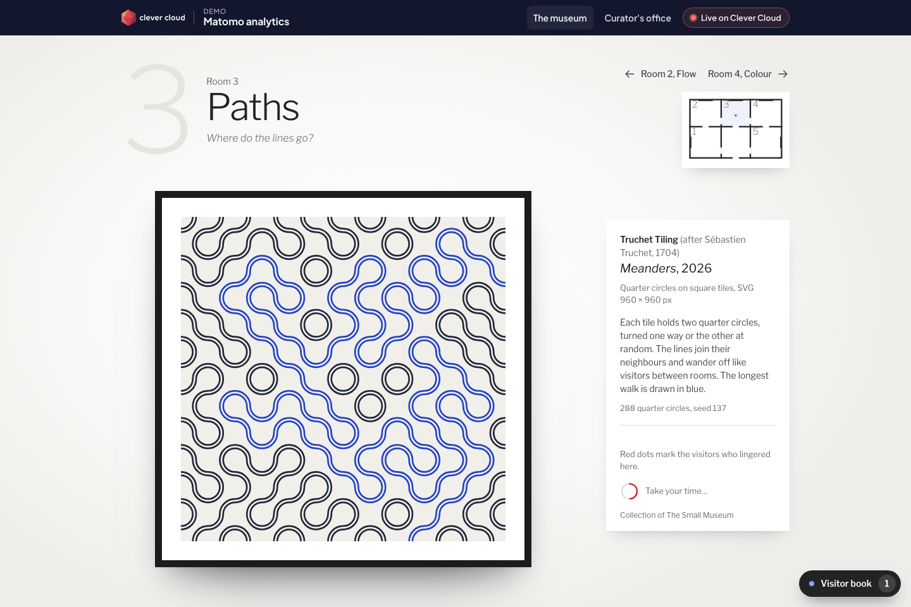
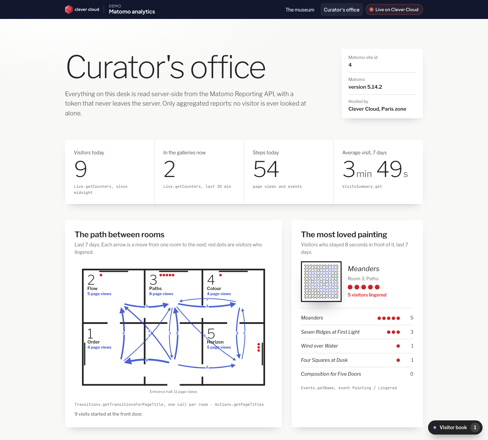
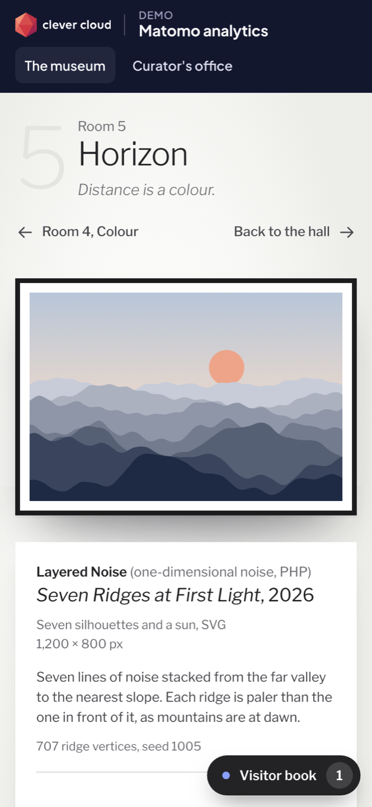
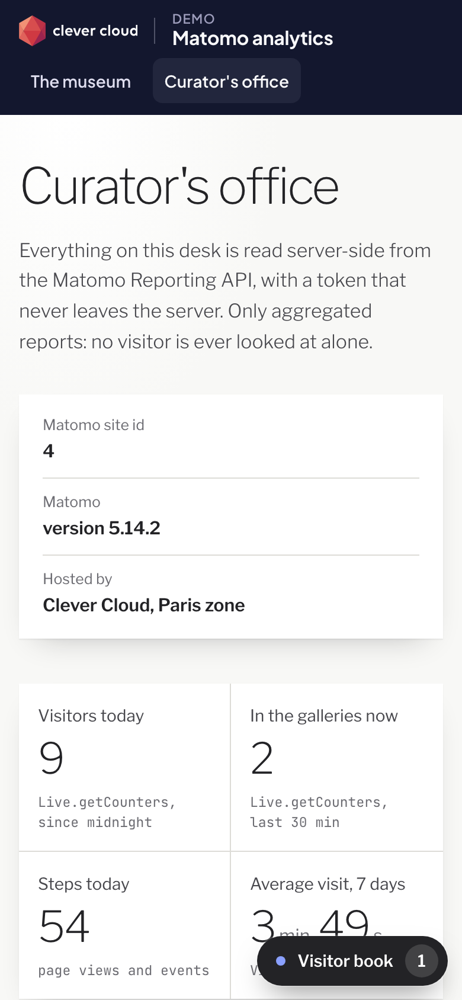

# The Small Museum — Matomo analytics on Clever Cloud

> A tiny white-cube museum: five rooms, five paintings drawn by code. Walk from room to room and the **Matomo add-on** counts the visits, the page views, the time spent and every painting you stand in front of for eight seconds. Behind the galleries, the **curator's office** reads it all back, server-side, from the Matomo Reporting API: visitors today, the most loved painting, the path between rooms. No cookie is set, the data stays in Paris, and the API token never leaves the server.





| Phone, in a room | Phone, the office |
|---|---|
|  |  |

**Run it yourself.** The hosted demo was taken down after the presales review (November 2026). The steps in [Deploy on Clever Cloud](#deploy-on-clever-cloud) recreate it from scratch in about 15 minutes, including the Matomo sign-in and token below.

## What Matomo does in the demo

| Where | Matomo feature | What you see |
|---|---|---|
| Every page | JavaScript tracker (`matomo.js`) with `disableCookies`, `enableHeartBeatTimer` | The **visitor book** (bottom right) lists each tracking call as the tracker wrote it |
| `/visitor-book` | Tracking HTTP API (`matomo.php`), first-party | The app forwards each hit to the add-on, forces the site id and adds the visitor IP (`cip`) with the server-side token, so Matomo anonymises the real address |
| A room | Custom event `Painting / Lingered / <title>` after 8 s in front of the painting | A red dot lands on the cartel, like a sticker at an art fair |
| `/curator` | Reporting API, one `API.getBulkRequest` with 13 methods | `Live.getCounters` (today, last 30 min), `Transitions.getTransitionsForPageTitle` (path between rooms), `Events.getName` (most loved painting), `Actions.getPageTitles` (page views per room), `VisitsSummary.get` (7 days), `PrivacyManager.getComplianceStatus` (CNIL mode) |
| Start-up | `SitesManager.addSite` and bulk tracking | The seed creates the site *The Small Museum* (Europe/Paris) and, the first time only, an opening night of seven visitors |

The office only reads **aggregated reports**, never the visits log, so it keeps working when Matomo's CNIL compliance mode is enforced. It shows the mode's status live: with the mode enforced and the opt-out in the footer, Matomo's [CNIL guide](https://matomo.org/faq/how-to/how-do-i-configure-matomo-without-tracking-consent-for-french-visitors-cnil-exemption/) says the audience can be measured without a consent banner.

## Deploy on Clever Cloud

You need [clever-tools](https://www.clever.cloud/developers/doc/cli/) (`clever login` done) and the ID of the organisation that will own the resources (`orga_…`, shown in the Console). Run the commands from the repo root: `clever create` links the folder to the new app.

```bash
# 1. The app and its size
clever create --type php demo-matomo --org <org_id> --region par
clever scale --min-flavor nano --max-flavor XS --min-instances 1 --max-instances 2
clever scale --build-flavor M

# 2. Matomo (plan beta; the provider offers no encryption option)
clever addon create addon-matomo demo-matomo-museum --plan beta --region par --org <org_id> --yes
#    note the "Access it" URL it prints: https://<id>-matomo.services.clever-cloud.com
clever service link-addon demo-matomo-museum   # injects no variable, hence MATOMO_URL below

# 3. Variables
clever env set CC_PHP_VERSION 8.5
clever env set CC_WEBROOT /public
clever env set CC_PRE_RUN_HOOK "php bin/seed.php"
clever env set MATOMO_URL https://<id>-matomo.services.clever-cloud.com   # the "Access it" URL
clever env set CC_HEALTH_CHECK_PATH /health

# 4. Deploy
clever deploy
clever open
```

The museum and the visitor book work right away (`/health/deep` answers 503 until the token below is set). Then give the curator the keys: an owner step, once, about two minutes:

1. Open the Matomo URL and **sign in with your Clever Cloud account** (the add-on uses Clever Cloud SSO; accept the permissions the first time).
2. In Matomo, **Administration › Personal › Security › Create new token**, and copy it.
3. `clever env set MATOMO_TOKEN <token>` then `clever restart`. The pre-run hook `bin/seed.php`, the only setup script, then creates the site *The Small Museum* and sends its opening night; it is idempotent and never fails a deployment.
4. Check `https://<your-app>.cleverapps.io/health/deep` returns 200, then open `/curator`.

Optional, for a snappier live demo: Matomo on Clever Cloud queues hits in batches of 25 (QueuedTracking) and archives reports on a schedule. Lower the batch size in *Administration › System › General settings*. To show the CNIL mode live, enforce it in *Administration › Privacy › Compliance* and reload the office.

## Variables

| Variable | Set by | Role |
|---|---|---|
| `MATOMO_URL` | you | Address of the Matomo add-on. The add-on does not inject variables into linked apps, so the app needs this one |
| `MATOMO_TOKEN` | you, from Matomo (owner step above) | Matomo API token, read server-side only (POST body, never in a URL or a page) |
| `MATOMO_SITE_ID` | optional | Forces a site id instead of the one found or created by the seed |
| `CC_WEBROOT` | you | `/public` |
| `CC_PRE_RUN_HOOK` | you | `php bin/seed.php`: idempotent seed, never fails the deployment |
| `CC_PHP_VERSION` | you | `8.5` |
| `CC_HEALTH_CHECK_PATH` | you | `/health` |

The "Running on Clever Cloud" panel shows `CC_APP_NAME`, `APP_ID`, `INSTANCE_NUMBER`, `INSTANCE_TYPE`, `CC_PRETTY_INSTANCE_NAME`, `CC_COMMIT_ID` and `CC_DEPLOYMENT_ID`, and nothing else.

## Routes

`/` hall and floor plan · `/room/1` to `/room/5` · `/curator` and `/curator/live` (desk fragment, refreshed every 15 s) · `/visitor-book` (tracking endpoint) · `/visitor-book.js` (Matomo's tracker, served from the app's domain) · `/painting/{n}.svg` · `/health` (no add-on) · `/health/deep` (tracker endpoint and Reporting API).

## Code tour

```
public/index.php      front controller: routes, tracking proxy, health checks
src/Matomo.php        the Matomo client: Reporting API (bulk), Tracking API (forward, bulk)
src/Curator.php       the office: one bulk request, turned into numbers, flows and dots
src/Seed.php          start-up seed: find or create the site, opening night
src/Painter.php       the five generative paintings (SVG, seeded, deterministic)
src/FloorPlan.php     the architectural floor plan, with flows and red dots
public/assets/        museum.css, museum.js (tracker set-up, visitor book, lingering)
views/                plain PHP templates; brand/ holds the Clever Brand Kit files
tests/run.php         33 checks: php tests/run.php (fake Matomo, real app on php -S)
```

Plain PHP 8.5, no framework, no Composer dependency.

## Run locally

```bash
MATOMO_URL=https://<your-matomo> MATOMO_TOKEN=<token> php -S 127.0.0.1:8100 -t public public/index.php
php tests/run.php
```

MIT License.
